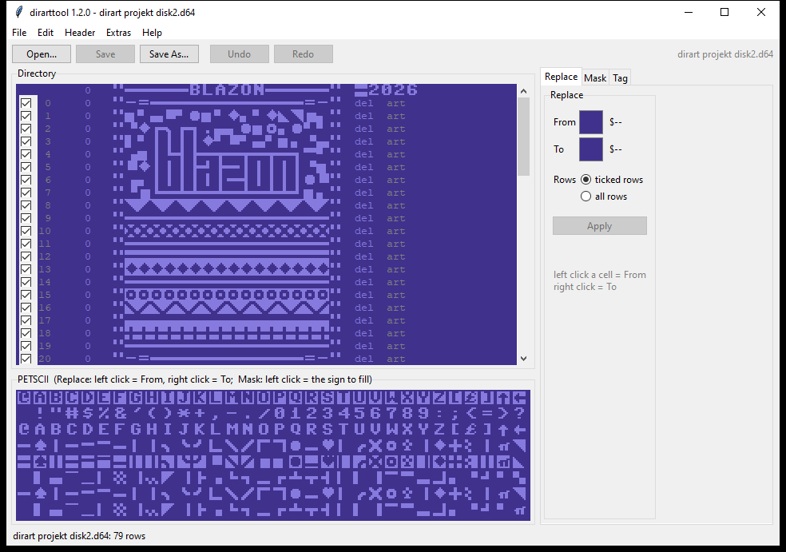
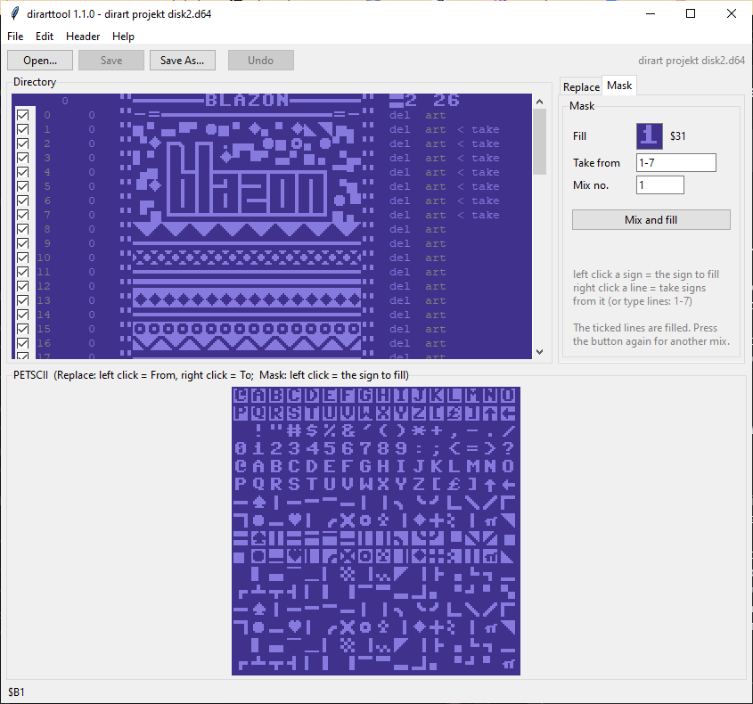

# dirart-tool

Batch-edit the **directory art** on a C64 `.d64`: turn one PETSCII character into another across every row at once, fill a stamp's free cells with a mix of signs from other lines, and carry a header and ID from one disk to another. From a window or from the command line.

Carsten's test disk has three rows that should look the same but don't: the inner corners are a filled circle on row 0, a cross on row 1 and an open circle on row 2. Two replacements, `$D6` to `$D1` and `$D7` to `$D1`, over all rows:

```
$ dirarttool "Baracuda - dir file.d64" --replace D6=D1 --replace D7=D1 --dry-run

         0 "                "    2A
  0      0 "..  BARACUDA  .." del
  1      0 "..  BARACUDA  .." del
  2      0 "..  BARACUDA  .." del

[*] 4 cells changed
[*] dry run -- nothing written
```

The same thing in the window, with the glyphs as the C64 draws them:



Only the 16 name bytes of the rows you pick are ever written, plus the header and ID when you ask for those. File types, block counts, sector links, the block map and every data sector stay exactly as they were.

---

## Contents

- [What directory art is](#what-directory-art-is)
- [The ideas](#the-ideas)
- [Install](#install)
- [The window](#the-window)
- [Command line](#command-line)
- [Exit codes](#exit-codes)
- [How it works](#how-it-works)
- [Where the glyphs come from](#where-the-glyphs-come-from)
- [Limitations](#limitations)
- [Building from source](#building-from-source)
- [Credits](#credits)

---

## What directory art is

A 1541 directory is a chain of 32-byte entries on track 18. Each entry has a file type, a start sector, a 16-character name and a block count. An entry whose type is a closed DEL with zero blocks lists like any other entry but owns no data and loads nothing: it is a free row of 16 characters. Stack enough of them and the listing draws a picture. The scene has done this since the eighties.

Drawing it is one job, and tools exist for it: DirMaster, or [txt2dirart](https://github.com/turrican128/txt2dirart) when the art lives in a text file and the disk is mastered by a script. **Changing** it afterwards is another job, and that is what this tool does.

## The ideas

All of them come from Baracuda/Blazon, who had been looking for someone to code them for years.

**Dirart Replacer.** Existing characters are replaced by other characters, across all lines at once. Every `0` becomes `-`. Every cross becomes a filled circle.

**Dirart Mask.** "Take, mix and insert." A stamp is drawn with a placeholder sign in its free cells, `1` on Baracuda's test disk. The Mask fills every placeholder with a sign taken from lines you point at, the finished art above the stamp for example, mixed so that every line comes out different. The stamp's own signs stay where they are.

**Header and ID buffer.** Copy the header of one disk, open another and write it there. The same for the ID, or both together.

## Install

**Binaries** need nothing on the machine, not even Python. Grab the zip from Releases:

```
dirarttool.exe          Windows
dirarttool              Linux x64
```

Double-click the exe for the window. On Windows a console window opens behind it; that is the same binary serving the command line, and it goes away with the window.

**From source**: `python dirarttool.py`. Python 3.9 or newer, with Tk (every python.org build has it). No packages to install.

## The window

**Open** a `.d64`, or **drop one onto the window** from Explorer. The directory is drawn the way `LOAD"$",8` lists it, with the real C64 glyphs. Art rows are ticked, real files are not, and a grey number on the left is the row index the command line uses. (Dropping onto the window is Windows-only; it talks to the shell directly, no extra package. Dropping a `.d64` onto `dirarttool.exe` itself works too, on any system: the file is passed as the one argument and the window opens with it.)

### Replace

1. **Left-click** any cell, in the directory or in the PETSCII palette below, to make it *From*. **Right-click** one to make it *To*. The two boxes show the glyph and its hex.
2. **Apply.** Every *From* in the ticked rows becomes *To*, whichever line you clicked it in. The status says how many cells changed. **Undo** takes it back.
3. One replace changes one sign. If three lines hold three different signs and all should become the same, that is one replace per sign: pick the next *From* and Apply again.

### Mask

1. Switch to the **Mask** tab and **left-click** the placeholder, a `1` in the stamp for example. It shows as *Fill*.
2. **Right-click** the lines to take signs from; each gets a `< take` mark, and a second right-click takes it off again. Or type them in *Take from*: `1-7`, or `1-7,21-27`. Nothing is taken from a line you did not choose, so separators, text and test rows elsewhere on the disk cannot leak into the stamp.
3. **Mix and fill.** Every placeholder in the ticked lines gets the sign of the same column in one of the source lines, picked at random, and no two filled lines come out the same when the sources allow it.
4. Not the one? Press the button again (**Mix again**) for the next mix. The *Mix no.* names the mix, so typing a number brings that exact one back. **Undo** returns to the empty stamp.



A column where no source line has a usable sign is left as it is and counted in the status. A source cell holding the placeholder itself, `$A0` or `$00` is never taken.

### Header and ID

| key | does |
|---|---|
| F1 | copy the header of the open disk |
| F3 | write the copied header onto the open disk |
| F5 | copy the ID |
| F7 | write the copied ID |
| F2 | copy header and ID |
| F4 | write header and ID |

Open the first disk, press F1, open the second disk, press F3. The buffer survives opening disks, so one header can go onto as many disks as you like. The same six actions are in the **Header** menu. "The ID" is all five characters a listing prints after the header, the two ID bytes and the DOS type next to them, because dir art uses all five.

### Saving

Everything above changes the picture in the window only. **Save** rewrites the file; **Save As** suggests `<name>-dirart.d64` next to it. **Undo** steps back through replaces, mixes and header writes alike.

Ticking a real file and applying a change that would touch its name asks first, once per disk, because it changes the name you `LOAD`. Closing or opening with unsaved changes asks too.

Keyboard: Ctrl+O, Ctrl+S, Ctrl+Shift+S, Ctrl+Z, F1 to F7 as above.

## Command line

```
dirarttool disk.d64 --replace D6=D1 --replace D7=D1           # art rows, in place
dirarttool disk.d64 --replace 0=- --rows 1,2,3 --dry-run        # these rows, just show me
dirarttool disk.d64 --replace A0=20 --all-rows -o out.d64       # real files too, to a new file
dirarttool disk.d64 --mask 1 --mask-from 1-7                    # fill every 1 from lines 1-7
dirarttool disk.d64 --mask 1 --mask-from 1-7 --seed 7 --dry-run # this exact mix, just show me
dirarttool disk.d64 --header-from other.d64 --id-from other.d64 # header and ID of another disk
dirarttool                                                      # the window
dirarttool disk.d64                                             # the window, with this disk
```

- `--replace FROM=TO`, repeatable. Each side is **two hex digits** (`D6`, the way dir artists talk about PETSCII) or **one printable character** (`X`, `0`, `-`; letters are uppercased). Hex wins when both readings fit: `10` is $10, not the digits 1 and 0. All replacements are applied in one pass per cell, so `--replace A=B --replace B=A` swaps the two.
- To replace the minus sign itself write it in hex (`2D=0`) or as `--replace=-=0`, because the shell's option parser reads `-=0` as an option. `==-` works as written: the first character is the one being replaced.
- `--mask CHAR --mask-from ROWS` fills every CHAR in the chosen rows with signs from the same column of the ROWS lines. `--mask-from` is required: the tool does not guess which lines are art worth taking from. `--seed N` fixes the mix so a run can be repeated; without it every run mixes anew. With `--replace` in the same run, the replace happens first.
- `--header-from OTHER.D64` and `--id-from OTHER.D64` put the header, or the five ID characters, of another disk on this one. Give both for header and ID.
- **Rows.** Without `--rows`, every art row. `--rows 1,2,3` picks rows by the index the listing shows; ranges work too, `--rows 1-7,21`.
- **Real files.** `--all-rows` is the consent flag. Without it, the default scope skips real files, and naming one in `--rows` is refused with its name in the message, so a build script cannot rename a file by accident. `--rows 7 --all-rows` changes row 7 even though it is a file.
- `--dry-run` prints the resulting listing and the cell count and writes nothing. `-o` writes a new file and leaves the input alone. Without `-o` the input is rewritten in place, atomically.
- `-q` for no progress lines, `--version`.

## Exit codes

| code | meaning |
|---|---|
| 0 | done, or dry run |
| 2 | bad arguments: a `--replace` that does not parse, FROM equal to TO, a row that does not exist, an empty row list, a real file without `--all-rows`, `--mask` without `--mask-from` |
| 3 | not a `.d64` (the disk itself, or the one named in `--header-from` / `--id-from`), or a directory chain this tool refuses to touch |
| 4 | the output could not be written; the input is untouched |

Each code is its own exception class in the source, so a script can branch on it.

## How it works

The engine reads the directory chain on track 18 exactly as txt2dirart does, with the same refusals: a chain that leaves track 18, loops, or points at the BAM is a damaged or non-standard disk and is not touched. Each entry is a row with an index, a kind (`art` or `file`) and its 16 raw name bytes.

A replace walks the name bytes of the chosen rows and looks each one up once in the FROM-to-TO table. Nothing else in the image is read for writing, so the only bytes that can differ between input and output are those name bytes. The tests prove this by comparing whole images.

`$20` (space) and `$A0` (the shifted space the drive pads names with) are two different characters here and both can be replaced, by hex. That is what keeps real file names honest: a `$A0` is only touched when you ask for `$A0`.

The window follows the drive's closing-quote rule: the quote is printed at the first `$A0` in the name, later `$A0`s show as spaces, and any other byte after that point is drawn after the quote, which is the hidden-name trick. Every name byte keeps its own click target whatever the quote does.

The Mask builds, for each of the 16 columns, the list of signs the source lines show there, and draws from that list for every placeholder cell in that column. That is what keeps a filled stamp looking like the art it was taken from: a column that carries a border in the sources carries one in the result. A line that comes out equal to one already filled is drawn again.

The header and ID live in the BAM sector, track 18 sector 0: 16 bytes at `$90` and five at `$A2`. Those 21 bytes are the only ones a header write can change; the block map in the same sector is not touched.

Saving writes a temporary file next to the target and renames it over, so a crash can never leave half a disk image.

## Where the glyphs come from

The window draws with the uppercase/graphics half of the C64 character ROM (901225-01), 2048 bytes embedded in the source as a compressed blob so the binary needs no file beside it. The ROM ships inside every VICE download; `tools/make_charset.py <chargen.bin>` regenerates the blob from one.

## Limitations

- **35- and 40-track `.d64` only** (`174848`, `175531`, `196608`, `197376` bytes). No `.d71`, `.d81`, `.g64`.
- **The directory must live on track 18.** The rare disk whose directory continues elsewhere is refused rather than handled.
- **It does not add, remove or reorder rows**, and it does not edit file types or block counts. A header or ID can be taken over from another disk, not typed in. txt2dirart stamps rows; DirMaster does the rest.
- **It does not paint.** Replacing one character with another across rows is the whole idea; a cell-by-cell editor is a different tool.
- **Uppercase set only.** Directory art is drawn for the charset a listing uses.

## Building from source

```sh
git clone https://github.com/turrican128/dirart-tool
cd dirart-tool
python -m pytest tests/ -q
```

The tests need only Python and pytest. The fixture disks are committed as binaries; one of them is Baracuda's own test disk, which is the acceptance test for the Replacer.

### QA gate

After any change, before any tag:

```sh
python tools/qa.py            # everything; read the last line
python tools/qa.py --quick    # without the window checklist
```

It runs the whole test suite, a stdlib-only smoke run of the tool, a byte-for-byte comparison of the Replacer's output on Baracuda's disk against the committed golden image (`tests/fixtures/golden-baracuda-replaced.d64`, rebuilt and verified by `tools/make_golden.py`), and `tools/qa_window.py`, which opens the real window and walks the nine-item release checklist by calling the same methods the buttons call. The last line is `QA: PASS` or `QA: FAIL <stage>`; nothing else counts.

Release binaries are built by GitHub Actions with PyInstaller on `windows-latest` and `ubuntu-latest` when a `v*` tag is pushed. The workflow runs the tests first and refuses to build if they fail.

## Credits

code DR.J/Delysid, idea and test disk Baracuda/Blazon.

The disk code is txt2dirart's. MIT licensed. Do what you like with it.
